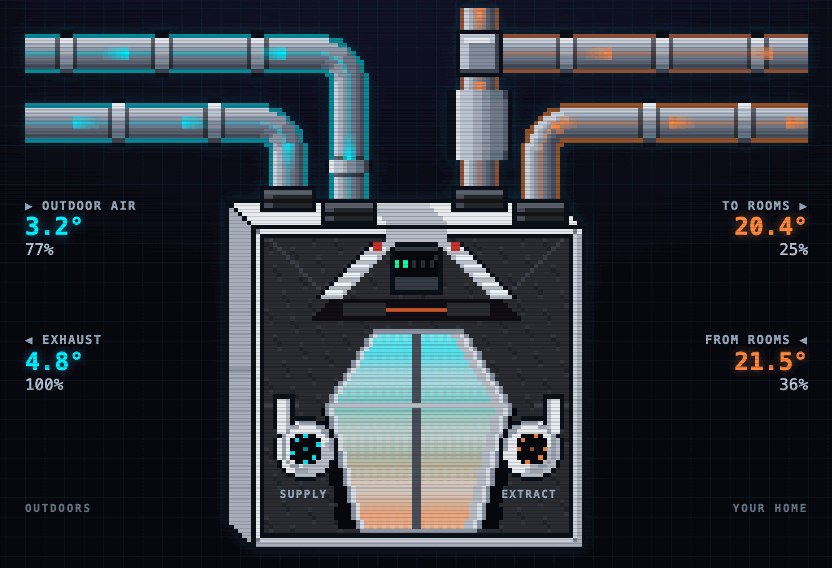

# Zehnder ComfoAir Q Firmware

<p align="center">
  
  
  
  
  
  
</p>

**A direct CAN bridge for a Zehnder ComfoAir Q — no ComfoConnect gateway, no cloud, no YAML.**

Own firmware for the **Zehnder ComfoAir Q** heat-recovery ventilation unit
(Q350, Q450, Q600; MVHR / HRV), on an ESP32 node wired to the unit's CAN bus.
It talks to the unit directly: no ComfoConnect LAN C gateway, no cloud. Three control
surfaces over one model: **MQTT with Home Assistant discovery, HTTP REST and a web UI
of its own.** One published binary, everything configured at runtime in a browser.

<p align="center">
  
  <br>
  <sub><code>// WHERE THE AIR GOES</code> — cold outdoor air in on the left, warm room air in on the right, both fans turning at the real airflow</sub>
</p>

> [!WARNING]
> **`SYSTEM STATUS: 0.1.0`** — the CAN link, REST, MQTT with Home Assistant discovery,
> commands, provisioning and OTA are in, but nothing has been accepted on a real
> ComfoAir Q yet. What is in: [`CHANGELOG.md`](CHANGELOG.md); how the firmware works:
> [`docs/`](docs/index.md); the scenarios still to walk:
> [`docs/hardware-verification/`](docs/hardware-verification/).

## ▸ What it does

- Decodes the values the unit broadcasts on the bus and polls the rest: 76 entities of the
  Q350/450/600 base unit — temperatures, humidities, fan speeds and flows, power and energy,
  filter state, operating mode, bypass, active errors and diagnostics.
- Controls the unit through its writable entities — the fan with its presets, the bypass,
  balance and temperature-profile selects, the away switch — and six parameterised operations
  (`boost`, `set_bypass`, `set_balance_mode`, `set_ventilation_level`, `set_temperature_profile`,
  `set_away`) that take all their parameters in one call over REST or MQTT.
- One entity list (`tools/pdo_table.py`) generates the REST paths, the MQTT topics, Home Assistant
  discovery and the web UI's types, so a value has the same key everywhere.
- A web UI served by the device: **Home** (the unit scene, airflow, filter wear and the everyday
  controls), **Diagnostics**, **Unit capabilities** (a read-only RMI walk), **System**,
  **Settings**, **Log** and **Update**. English, with DE/NL/UK translations; Home Assistant stays
  English.
- Sets itself up from a browser: its own access point, a captive portal, a bounded setup window,
  and a rollback to the last working Wi-Fi if a new password is mistyped.
- Updates by uploading a `.bin` in the web UI, with automatic rollback if the new image does not
  come up. The board's LEDs show its state; its button opens the setup network or clears settings.
- Never reboots because something else is missing: a dead router, a stopped broker or a silent
  CAN bus are retried for as long as they last, and the web UI stays up meanwhile.

**Not here, by design:** no TLS to the broker (plain TCP on 1883), no network-pulled updates, no
Improv Wi-Fi, no Ethernet — Wi-Fi only, 2.4 GHz.

## ▸ Hardware

v1 targets one board: **M5Stack NanoC6** (ESP32-C6, 4 MB). CAN on GPIO2/GPIO1 at
50 kbps through an M5Stack Unit Mini CAN on the Grove port. Other boards are anticipated by the
code layout — pins live only in `components/board/` — but none is supported yet.

## ▸ Building

Needs Node (the web UI is compiled into the firmware, so `npm` runs as part of
the build) and PlatformIO.

```sh
pio run -e m5stack-nanoc6          # firmware, front end included
pio run -e m5stack-nanoc6 -t upload
pio device monitor
```

`platform` resolves to the [pioarduino](https://github.com/pioarduino/platform-espressif32)
platform, which is the distribution carrying ESP-IDF 5.5.5 and an ESP32-C6 board
catalogue. `framework = espidf`; there is no Arduino layer anywhere in this tree,
deliberately: everything the firmware needs is first-party in ESP-IDF —
`esp_http_server` with WebSocket, `esp-mqtt`, cJSON, TWAI, `esp_wifi`, NVS,
`esp_ota_ops`, mDNS — so no Arduino library earns its place.

## ▸ Versioning

SemVer 2.0.0, and **the git tag is the only source**: nothing else holds a version number.
`python3 tools/version.py` prints what this tree builds — `0.1.0` exactly on a clean `v0.1.0`,
`0.1.1-dev.3+gabc1234[.dirty]` three commits past it, `0.0.0-dev.N+g…` before the first tag.
The build stamps it into the image, and it is what `/api/system` and Home Assistant show.
To cut a release: move `## [Unreleased]` in `CHANGELOG.md` to `## [0.1.0] - <date>` and
commit, then `git tag -a v0.1.0 -m "0.1.0"` and `git push origin v0.1.0`. The release
workflow refuses a tag that is not the tree's version or has no changelog section. Rules and
rationale: [`docs/development/releasing.md`](docs/development/releasing.md); the derivation
table itself is the contract in `tools/version.py`'s docstring.

## ▸ Layout

```text
src/                    application entry point
components/board/       the board boundary: pins, bitrate, transport
components/comfoair_*/  one component per responsibility
components/web_assets/  the SPA, gzipped by Vite and embedded with EMBED_FILES
web/                    Preact + Vite + TypeScript single-page application
test/                   host test suites, one directory each
tools/                  the entity table, the generator and the version tooling
installer/              the browser installer page (ESP Web Tools)
partitions.csv          two 1984 KiB OTA slots, no filesystem partition
docs/                   the as-built documentation site (guide, architecture, protocol, ...)
```

## ▸ Flash budget

```text
APPLICATION   [███████████████░░░░░] 1,475,692 B of 2,031,616 B  72.6 %
STATIC RAM    [█████████░░░░░░░░░░░]   154,084 B of   327,680 B  47.0 %
WEB UI (gz)                             121,857 B   compiled in
FREE HEAP                               112,208 B   lowest 105,592 B, largest block 94,208 B
```

Measured on `v0.1.0`. The first three come from `pio run -e m5stack-nanoc6`: the application
against one 1984 KiB OTA slot, and static RAM as `.data` + `.bss`. The heap figures are read from
`GET /api/system` on a NanoC6 2.5 minutes after boot, with WiFi up, the broker unreachable and no
ComfoAir on the bus. That makes them a ceiling, not a floor: an MQTT session and a talking bus
take more.

## ▸ Documentation

[`docs/`](docs/index.md) is a [VitePress](https://vitepress.dev/) site — the as-built design and
reference, and the authority for what the firmware does. It is not published yet.

| Section | What is in it |
| --- | --- |
| [`guide/`](docs/guide/) | introduction, installation, first setup, configuration, Home Assistant, updating, troubleshooting |
| [`architecture/`](docs/architecture/) | the overview, the components, the runtime, the failure model, security |
| [`protocol/`](docs/protocol/) | the ComfoAir Q CAN bus: PDO parsing, RMI reads and commands, polling |
| [`interfaces/`](docs/interfaces/) | the REST API, the WebSocket, MQTT, Home Assistant discovery, the web UI |
| [`device/`](docs/device/) | the board, the status LEDs, the button, networking, configuration storage, OTA |
| [`development/`](docs/development/) | building, testing, the entity registry, releasing, conventions |
| [`hardware-verification/`](docs/hardware-verification/) | the test scenarios to walk on a real unit, grouped by what the device does |
| [`reference/`](docs/reference/) | the generated entity table |

Beside the site: [`AGENTS.md`](AGENTS.md), the engineering rules that carry load. To serve the
site locally: `cd docs && npm install && npm run docs:dev`.

## ▸ Sibling project

[OpenTherm Thermostat Firmware](https://github.com/blade-running-man/opentherm-thermostat-firmware)
carries this firmware's infrastructure — Wi-Fi, HTTP, MQTT, configuration, provisioning, the web
UI shell — over to a gas boiler, as the sole OpenTherm master on its bus.

## ▸ Licence

MIT — see [LICENSE](LICENSE) and [NOTICE](NOTICE).
Copyright © 2026 Oleksandr Slukovskyi ([@blade-running-man](https://github.com/blade-running-man)).
